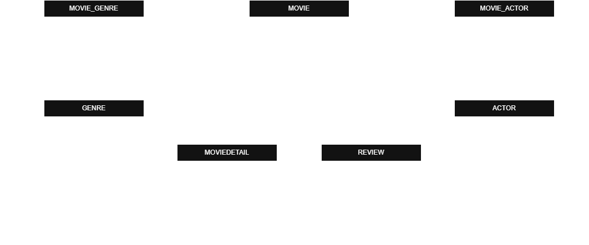

# MoveAPI

## 1. Projektbeskrivning

Movie API är ett ASP.NET Core Web API-projekt som använder Entity Framework Core (EF Core) för att hantera en filmdatabas i SQL Server.

Projektet använder Code First, vilket innebär att databasens struktur definieras genom C#-modeller. EF Core Migrations används sedan för att skapa och uppdatera databasen utifrån modellerna.

Databasen heter MovieDb.

**Tekniker**

* ASP.NET Core Web API
* Entity Framework Core
* SQL Server
* EF Core Migrations
* C#

## 2. Databasens struktur

Databasen består av följande tabeller:

| Tabell | Beskrivning |
| --- | --- |
| Movie | Grundinformation om filmer |
| MovieDetails | Fördjupad information om en film |
| Review | Recensioner av filmer |
| Actor | Skådespelare |
| Genre | Filmgenrer |
| MovieActor | Koppling mellan filmer och skådespelare |
| MovieGenre | Koppling mellan filmer och genrer |

## 3. Relationer och designbeslut

### Movie - MovieDetails (1:1)
En film kan ha noll eller en post med detaljer.

MovieDetails är valfri eftersom en film ska kunna skapas innan all fördjupad information finns tillgänglig.

* Movie.MovieDetails är nullable.
* MovieDetails.MovieId är en obligatorisk foreign key.
* En MovieDetails-post måste tillhöra en film.
* En film kan sakna MovieDetails.

Detta är ett medvetet designbeslut som gör det möjligt att komplettera informationen senare.

### Movie – Review (1:N)
En film kan ha flera recensioner, men varje recension tillhör en film.

* Movie.Reviews är en samling.
* Review.MovieId är foreign key.
* Review.Movie pekar på filmen som recensionen tillhör.

Betyget ska vara mellan 1 och 5.

### Movie – Actor (N:M)
En film kan ha flera skådespelare och en skådespelare kan medverka i flera filmer.

Relationen hanteras genom kopplingstabellen MovieActor.

Den innehåller:
* Id
* MovieId
* ActorId
* Role

Role anger vilken roll skådespelaren har i filmen.

Jag hade kunnat skapa en sammansatt primärnyckel med (MovieId, ActorId) vilket förutsätter att enbart en skådespelare per film.
Detta hindrar att registrera filmer där en skådespelare spelar flera olika karaktärer, såsom Austin Powers. Av denna anledning har jag valt att varje koppling har en egen PK.

### Movie – Genre (N:M)
En film kan tillhöra flera genrer och en genre kan användas av flera filmer.
Relationen hanteras genom kopplingstabellen MovieGenre.

Den innehåller:
* MovieId
* GenreId

Denna tabell använder en sammansatt primärnyckel: (MovieId, GenreId)

Genre ligger i en separat tabell för att undvika att samma genre behöver skrivas in och lagras på nytt för varje film.

### Flödesschema

